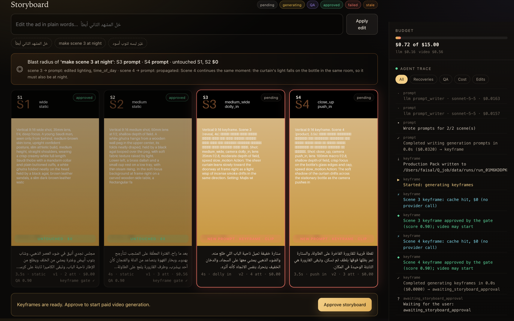
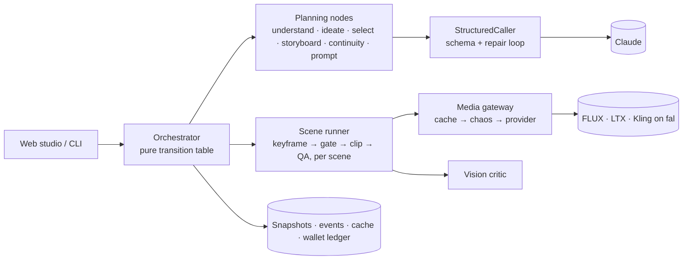
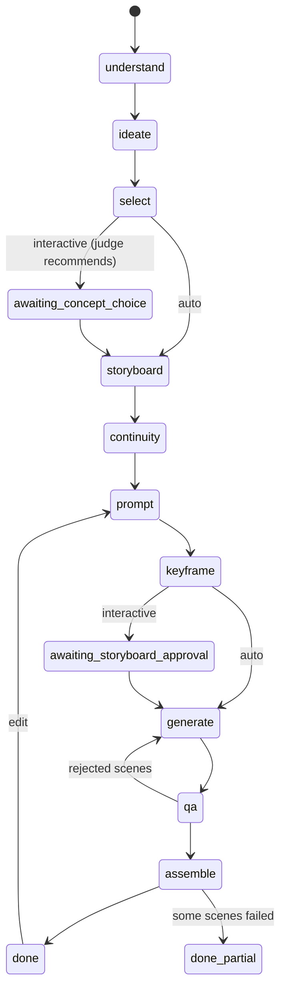
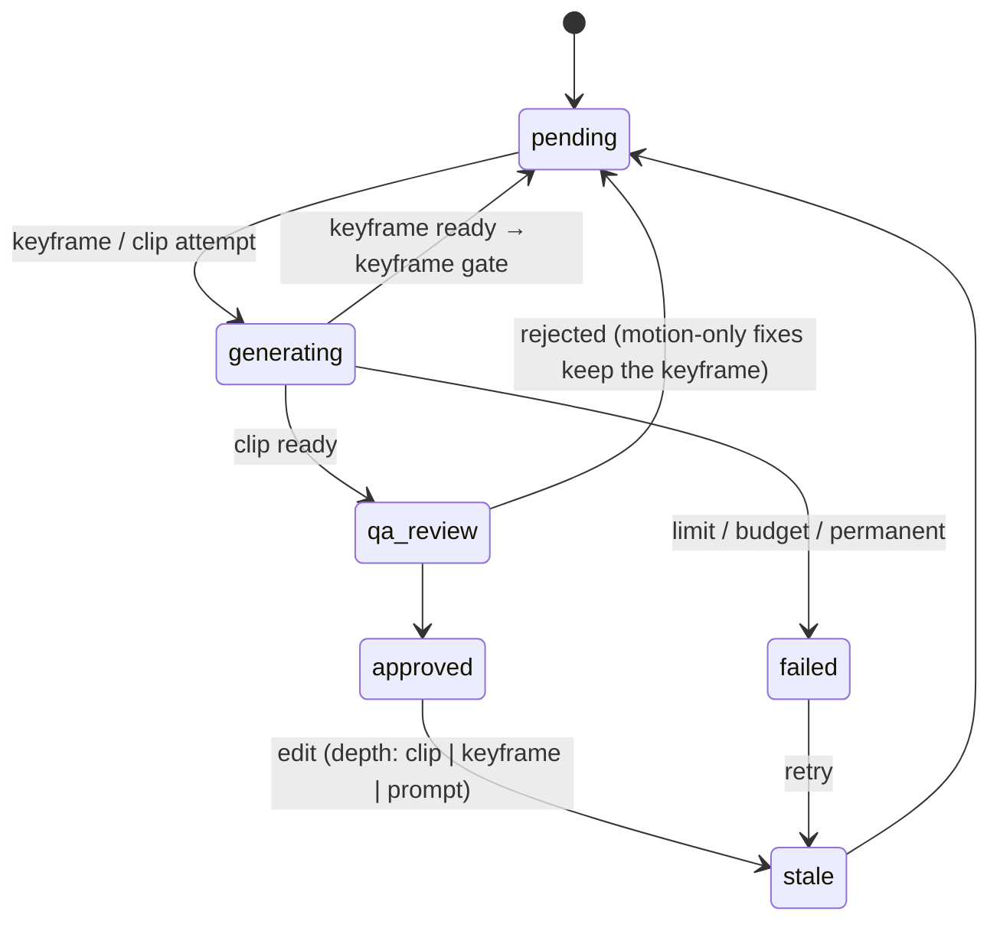

# Adsmith

**Video walkthrough (11 min, Arabic):** [youtu.be/elmyNQbRDro](https://youtu.be/elmyNQbRDro)

**An ad agent with an explicit, typed, recoverable brain.** Ask for *"a 15-second ad for a luxury
men's perfume, cinematic"*, in English, Modern Standard Arabic or Saudi dialect. Adsmith writes
3 concepts, judges them, storyboards the winner with DP-level shot specs, writes prompts,
generates and checks keyframes and then clips, recovers from failures, and assembles the ad with
an Arabic end card. Change your mind with *"خل المشهد الثاني أبطأ"* ("make the second scene
slower") and only that scene's clip is regenerated. It runs with **zero API keys** (scripted LLM +
mock media), and it was tested on **real models**: Claude for reasoning, and on fal.ai FLUX dev +
FLUX Kontext keyframes, **Kling v3 Standard** clips and Lyria 2 music for the final ad (LTX-2.3
and Kling v3 Pro were tested in earlier rounds).



<sub>Web studio after the edit *"make scene 3 at night"*: scenes 3–4 regenerate at prompt depth
(scene 4 because it continues the same moment), scenes 1–2 untouched at $0. More screenshots in
[docs/screenshots](docs/screenshots).</sub>

---

## Quickstart A: zero keys (≈2 minutes)

```bash
make setup        # uv sync, Python 3.12
make demo         # ~20 s: chaos run with recoveries → Arabic end card → an edit → kill + resume
uv run adsmith serve   # web studio at http://127.0.0.1:8000 (live pipeline view: docs/screenshots/ui/)
```

`make demo` runs the Arabic perfume request with **Chaos Mode** on: injected transient errors,
content-policy rejections and QA failures, each recovered and labelled in the live trace. Then
it applies the edit *"خل المشهد الثاني أبطأ"* and prints the blast radius. Finally it kills a second
run with SIGKILL mid-generation and resumes it without paying twice.

## Quickstart B: real models

```bash
echo 'ANTHROPIC_API_KEY=sk-ant-...' >> .env
uv run adsmith run "سوّ لي إعلان 15 ثانية لعطر رجالي فاخر للشباب، بأسلوب سينمائي" --auto \
    --until keyframe                       # real planning, mock media (≈ $0.15, 90 s)

# optional real media (fal.ai). The wallet ceiling is mandatory:
echo 'FAL_KEY=...' >> .env
ADSMITH_LLM_PROVIDER=anthropic ADSMITH_MEDIA_PROVIDER=fal ADSMITH_FAL_BALANCE_USD=10 \
ADSMITH_BUDGET_USD=3 uv run adsmith run "<request>" --auto
```

Other commands: `choose`, `approve`, `edit`, `retry`, `resume [--from-version N]`, `assemble
[--partial slate]`, `trace [-f]`, `show`, `export`, `list`, `history`, `serve`.

---

## The creative layer and one-generation ads (new)

The first version was an engineering proof: it could make an ad reliably, but the ads were
templates. Two things changed (ADR-0022 to ADR-0025):

1. **Ideas before shots.** A new `insight` stage names the category's clichés and 3–5 human
   truths. Each of the three concepts stands on one truth and carries a story with a turn, a hook
   (what you see and hear in the first two seconds, and the question it opens), the product's role
   (hero, catalyst, reward or witness) and culture as meaning, not decoration. The judge scores six
   criteria from `config/rubric.toml` (insight, hook, story and turn, originality, culture as
   meaning, product's role); code weights them and picks. Ease of execution is no longer scored.
2. **One generation per ad.** With a real product photo the run uses the `multishot` format: the
   storyboard becomes ONE numbered-shot prompt (camera, lighting and sound per shot) rendered by a
   single Seedance reference-to-video generation on Higgsfield, with native sound. The 8-clip
   montage and narrative paths are unchanged when there is no photo.

```bash
# zero keys: scripted LLM + a mock reference-to-video model (real files, with sound)
uv run adsmith run "Make a 12-second ad for my perfume" --product-photo my_photo.png --auto
# real: Higgsfield prices the generation first; the run stops at the spend gate
ADSMITH_LLM_PROVIDER=anthropic ADSMITH_AD_PROVIDER=higgsfield \
  uv run adsmith run "<request>" --product-photo assets/perfume.jpeg --auto
uv run adsmith approve <run>        # or: adsmith decline <run>
```

**Kie.ai** renders the same Seedance 2.0 reference-to-video model at a published per-second
credit price (ADR-0027): `ADSMITH_AD_PROVIDER=kie ADSMITH_KIE_BALANCE_USD=<prepaid USD>`
(`ADSMITH_KIE_RESOLUTION=480p` for the cheapest render; 6 s at 480p = 70.2 credits ≈ $0.35).
`uv run adsmith kie-balance` shows the account's credits (a free call). The wallet settles at the
credits Kie reports for the task. Kie has no idempotency key, so a submit whose answer is lost
pauses the run with the money held and is never resubmitted by code.

Money rules: the provider's own `/estimate` prices exactly the request; a run's budget or wallet
that cannot cover it refuses before any spend; **real money always waits for a human at the spend
gate**, even with `--auto`. The request id is persisted at submit, so a crash resumes by polling and
never pays twice. The whole-ad critic sees the photo and three frames per shot: the hard gate
(product identity, no text, brand safety, alcohol look) decides pass/flag by code, and the six
rubric scores give a creative score that only **warns** below 6.5. Nothing is regenerated
automatically: `adsmith accept-ad` or `adsmith regenerate-ad` (back through the spend gate).

### The system writes its own Seedance prompt (ADR-0026)

Two real generations needed a human to rewrite the prompt. A frame-by-frame comparison with a
competitor's product-review ad and a Seedance reference showed why: their product is on screen
93–100 % of the time, ours was 13–19 %. The pipeline now does what the human did:

- **Rules as data** (`config/creative_rules.toml`): product screen time, a person handling the
  product, a 2-second key moment and hero, one location, banned words with their replacements.
  Code checks every prompt against them; the repair loop fixes what breaks a rule.
- **A structured prompt**: the writer sees the product photo and names props with a physical
  description, the product's size per shot and the key shot; code renders a References block.
- **A creative director** (Opus) reviews the prompt rule by rule before the spend gate and
  rewrites it when a rule fails; code decides what is kept.
- **Prop images**: one per prop the prompt names, checked by vision against the product photo.
- **A Saudi culture bank** (`config/culture_bank.toml`) anchors each insight to a real ritual.
- **Critic v3**: windows from the video's own cuts, dense frames on the key moment and the first
  two seconds, execution warnings. **Audio** is normalised to −16 LUFS.

`uv run python scripts/decisions_report.py <run>` prints what to judge at the gate: insights with
their anchors, the three concepts with six scores, the director's verdicts, the images in order and
the final prompt with its price.

Status: built and tested on zero keys and a fake Higgsfield server. The two human-directed
generations above are the only real ones so far; the new planning stages have not yet run on real
models.

## The brain

**The LLM reasons inside nodes; it never picks the next stage.** Stages and transitions are a
declared table, and `next_stage(state)` is a pure function. Nodes return **typed deltas**; one
writer applies them and persists a **snapshot after every step** (SQLite, WAL, optimistic
locking). Any run can be resumed, forked from a past version, or replayed, and every LLM call,
retry and recovery is a typed event in the trace.





Each scene has its own sub-state machine. Only a keyframe that passed the gate is ever animated:



## Error handling

| Failure | Recovery | Limit |
|---|---|---|
| Transient (5xx, timeout) / 429 | full-jitter backoff inside the attempt; honours `retry-after` | 4–5 tries |
| Content policy (provider or LLM refusal) | LLM rewrite that keeps product, shot and intent | 2 rewrites |
| Keyframe gate rejects the still | prompt revised from the critic's fixes, new seed, cache evicted, **before any video spend** | 3 tries |
| QA rejects the clip | revision with the critic's fixes; keyframe kept unless the still is wrong | 2 regens |
| Invalid LLM output | same-conversation schema repair with exact validation errors | 2 repairs |
| Budget would be exceeded | refused **before** the call; scene fails alone | run cap + wallet |
| Provider account refused (e.g. balance) | the whole run pauses (resumable), no further paid calls | — |

- **Scene isolation:** each scene is its own task with atomic commits; one failure never blocks
  or invalidates another, and assembly skips the failed scene (or shows a slate).
- **Cache:** the request hash covers model, prompt, params and input keyframe. Known-bad outputs
  are evicted, so a "retry" can never be served the rejected image.
- **Budget guard:** estimate → reserve → settle/release, per run *and* in a cross-run **wallet
  ledger** with a hard ceiling (real fal spend was capped at the prepaid $10).
- **Crash-safe resume:** interrupted attempts release their reservations. The fal **request id is
  persisted right after submit**, so resume polls the job that is already running instead of
  paying for it again (tested end to end by killing the process).
- **Chaos Mode:** deterministic, seeded fault injection; every injected fault is labelled.

## Targeted edits

The edit is parsed into a typed patch. The scene reference is resolved **by code** (Arabic and
English ordinals); a conflict check decides whether neighbours continue the same moment; and a
pure blast-radius function decides what goes stale and how deep:

| Edit | Blast radius | Provider calls | Untouched |
|---|---|---|---|
| خل المشهد الثاني أبطأ ("make the second scene slower") | S2, clip only, keyframe kept | 1 | S1, S3, S4: **0 calls** |
| make scene 3 at night | S3 prompt + S4 (continues the same moment) | 4 | S1, S2: **0 calls** |
| غيّر لبسه لثوب أسود ("change his outfit to a black thobe") | bible v2, scenes showing the character | ≈2 each | S4 product shot: **0 calls** |

Ambiguous edits ("غيّر شي", "change something") get a clarifying question, never a guess.

---

## What real runs taught me

I spent about $18 of real fal credit; these lessons changed the design.

1. **The curtain veil.** *"A curtain shadow drifts across the bottle"* was taken literally: LTX
   rendered a translucent curtain over the product. The vision critic rejected it (0.50); the QA
   loop rewrote the motion prompt from the critic's fixes and the next clip was clean.
   ([before](docs/media/curtain_before_rejected.mp4) → [after](docs/media/curtain_after_fixed.mp4))
   This led to two prompt rules: video models take nouns literally (describe light as light), and
   nothing goes between the camera and the product.
2. **Calibrating the critic took three tries.** First it was *too lenient*: a clip with 2 major
   issues passed at 0.72. Then it was *too strict*: 10 of 10 keyframes rejected for staging details.
   The fix was a **hard/soft split**: product identity, readability, stray text and brand safety
   fail a shot; light side, props and composition only lower the score (capped by code). Re-judging
   14 stored keyframes: **12 of 14 verdicts right**; the 2 misses were a round cap the critic can't see.
3. **Keyframe gate.** Most rejections were really about the *still*, found only after paying for a
   clip. Reviewing the still alone first stopped 21 stills before animation across the M11 runs
   (≈ $0.56 of Kling each). The 10 in the first full run were mostly *false* rejections by the gate
   before it was calibrated; after calibration it rejected 1 of 5, correctly. Its one costly miss
   is lesson 7 ($2.24, a black cap passed as "minor"), which made any product mismatch a hard fail.
4. **LTX-2.3 Fast vs Kling v3 Pro.** LTX: ~35 s and $0.36 per clip, but it veils passing shadows
   and its push-ins are faint. Kling: 4–8 min and $0.56 per clip, keeps the product crisp with real
   parallax, but ignores light-only actions and adds smoke when particles are mentioned.
5. **Single-take experiment.** Concepts designed around the model's strengths: one 10 s take, both
   gates passed first time, $1.43, and the product looked identical for the whole take
   ([video](docs/media/single_take_final.mp4)). But the judge picked the safest concept, and the
   promised beat (the bottle flying at the lens) never happened. It passed QA as a "soft" issue.
6. **What the critic missed (I caught these by eye):** a doorway appearing mid-clip, bottle shapes
   differing between scenes ([majlis ad](docs/media/majlis_ad_final.mp4)), and a bottle that reads
   like whisky. That last one is now a hard check (`alcohol_free`).
7. **The hero attempt: a gate miss that cost $2.24.** The keyframe gate passed a black cap as a
   "minor" issue (the description said brushed gold), so best-of-2 Kling animated the wrong bottle,
   and the "blank label plate" became invented lettering in the close-up. Both takes were rejected.
   Now any product mismatch at the gate is hard by code, and product descriptions have no label
   surfaces; re-judged, that keyframe fails (0.78 → 0.45). Closed.
8. **The montage format, fully automatic (v1).** One Arabic request, `--auto`, no human edits.
   The agent chose the montage format by code, storyboarded 10 shots from a fixed shot
   vocabulary, locked one packshot and routed each shot's identity (Kontext from the packshot;
   macro shots are *cut from the packshot in code* and only relit, because Kontext kept
   re-framing or copying it). The bottle is identical in every shot. It generated its own music
   (Lyria 2, $0.10) and cut to the beat. But every physical event (water ribbon, splash, light
   sweep) failed the gates: **done_partial, 5 near-still product shots, 8.4 s**
   ([v1](docs/media/montage_v1.mp4), $3.07 of fal). Two fallbacks raced to the same shot, and
   light-only shots failed on Kling 2/2. Both became rules: fallbacks are decided one at a time
   and never leave a hole, and entries a model renders badly (`avoid_on`) never reach its
   storyboard.
9. **Montage v2: events by rule.** The grammar now asks for at least 3 physical-event shots
   (preferring ones that already passed on real media) and the hero push-in last. Same request,
   no human edits: a real horizontal spray from the nozzle, a drop on a leaf, droplets on the glass,
   the cap macro and a hero ending, **7 of 8 shots, 12.5 s** ([v2](docs/media/montage_v2.mp4),
   $3.09 of fal). It is much closer to the references, but it lost two things v1 had. **Music:**
   the track was reserved last and the clip retakes had used the cap, so music is now made when the
   clips start (the final v2 was re-assembled at $0 with v1's stored track, beat-cut to it).
   **Perfect identity:** the droplets shot turned the cap to crystal and the gate passed it, so the
   gate still misses fine material changes on small parts.

## Design decisions

- Custom state machine over LangGraph: control flow is data, not prompts. [ADR-0001](docs/adr/0001-custom-state-machine-over-langgraph.md)
- Typed state; every LLM output is a validated schema. [0002](docs/adr/0002-typed-state-and-structured-outputs.md) · [0012](docs/adr/0012-llm-layer-structured-calls-and-repair.md)
- Keyframe-first, with a keyframe QA gate before any video spend. [0003](docs/adr/0003-keyframe-first-generation.md)
- Error taxonomy → one recovery strategy per kind. [0004](docs/adr/0004-error-taxonomy-and-recovery-strategies.md) · [0015](docs/adr/0015-scene-execution-media-gateway-chaos.md)
- Blast radius by invalidation depth. [0005](docs/adr/0005-blast-radius-and-invalidation-depth.md)
- Model per node, chosen by measurement. [0007](docs/adr/0007-model-selection-per-node.md)
- Zero-key, mock-first design. [0008](docs/adr/0008-mock-first-zero-key-design.md)
- Snapshots + events in SQLite with a single writer. [0011](docs/adr/0011-storage-and-write-concurrency.md) · [0013](docs/adr/0013-run-loop-typed-deltas-and-failure-handling.md)
- Creative guardrails (clichés, insight, product presence). [0014](docs/adr/0014-creative-quality-guardrails.md)
- Vision critic: code decides pass/fail, hard/soft severity. [0016](docs/adr/0016-vision-qa-critic.md)
- Video-model capability profiles and the single-take format. [0017](docs/adr/0017-video-capability-profiles-and-single-take.md)
- Ad formats and a closed shot vocabulary (montage). [0018](docs/adr/0018-ad-formats-and-shot-vocabulary.md)
- Per-shot product identity routing and a cultural wardrobe lexicon. [0019](docs/adr/0019-identity-routing-and-wardrobe-lexicon.md)
- Peak-motion window, beat-cut assembly, best-of-2 on key shots. [0020](docs/adr/0020-peak-window-beat-cut-key-shot-takes.md)
- Macro crops from the packshot, vocabulary fallback, generated music. [0021](docs/adr/0021-macro-crop-vocab-fallback-generated-music.md)
- Higgsfield over REST (no SDK retries), estimate first, idempotent submits. [0022](docs/adr/0022-higgsfield-over-rest.md)
- One generation per ad (multishot) behind a human spend gate. [0023](docs/adr/0023-multishot-whole-ad-generation.md)
- Insight first, concepts with a story and a hook, rubric selection. [0024](docs/adr/0024-creative-layer-insight-and-rubric.md)
- Whole-ad critic: the hard gate decides, the creative rubric warns. [0025](docs/adr/0025-whole-ad-critic-rubric-warn-only.md)

## Limitations and "with more time"

Where it stands honestly:
- **One-generation ads are not proven on real output yet.** The Higgsfield path is tested only on
  a fake server; prices are unpublished (the estimate is the price); the model chooses its own cut
  points, so planned timecodes are approximate; the critic cannot hear the soundtrack; edits on a
  one-generation ad are rejected (regenerate the whole ad instead).
- **The critic misses fine material changes.** In montage v2 the droplets shot turned the cap into
  clear crystal and the keyframe gate passed it (0.78); the cap's shade also drifts between shots.
  The product reference image locks the shape, not every material detail.
- **No eval suite yet.** The critic was calibrated on 14 labelled cases (12 of 14 right). That is
  evidence, not a benchmark, and there is no automatic regression when a prompt template changes.
- **Single process.** SQLite + asyncio is right for one machine and one user. Many users need more.
- **Event shots are fragile.** A water ribbon and a splash failed the gate in every montage run; the
  vocabulary fallback keeps the ad whole, but those shots are still not reliable.

Next, in this order:
1. **An eval suite for the critic:** a labelled golden set of keyframes and clips, accuracy per
   issue category, run on every template change; then a cross-shot identity check against the
   packshot to catch material drift.
2. **Queue + workers + Postgres:** each orchestrator step becomes a job (steps are already
   idempotent), object storage for the CAS, per-user budgets.
3. **The escalation ladder:** when the same failure repeats, simplify the spec, then switch model,
   before falling back, instead of retrying the same request.

The full list is in [docs/MORE_TIME.md](docs/MORE_TIME.md).

## Repo map and quality gate

```
src/adsmith/domain/     Pydantic state, invariants, scene FSM      agent/       orchestrator, nodes, recovery, edit, QA
src/adsmith/providers/  Claude · scripted · fal · mock + adapters  storage/     snapshots, events, cache, wallet ledger
src/adsmith/api/        FastAPI + SSE + single page                cli/         Typer + Rich live trace, demo
src/adsmith/media/      frames, ffmpeg, Arabic end card            prompts/     versioned Jinja templates
config/                 models.toml (models, prices, profiles), chaos.toml, real_runs.toml
docs/                   PLAN · PROGRESS · ADRs · MORE_TIME · DEMO_SCRIPT · screenshots · media
```

`make check` = ruff + ruff format + **mypy --strict** + pytest: **792 tests** (plus 2 live tests
that run with `--live`). Recovery paths, edits, the wallet, crash/resume and the API all have tests.
