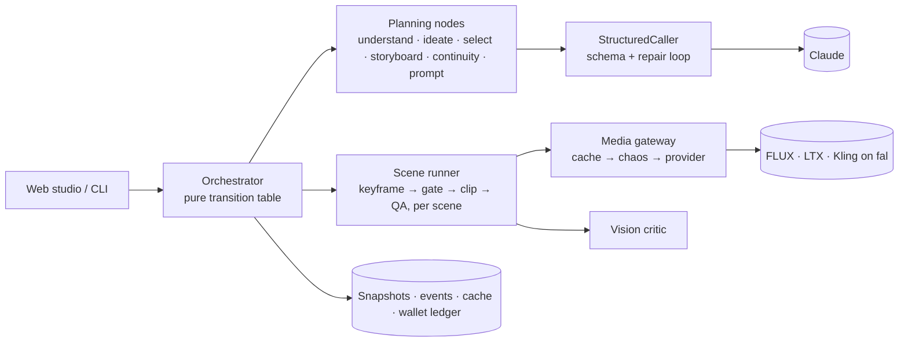
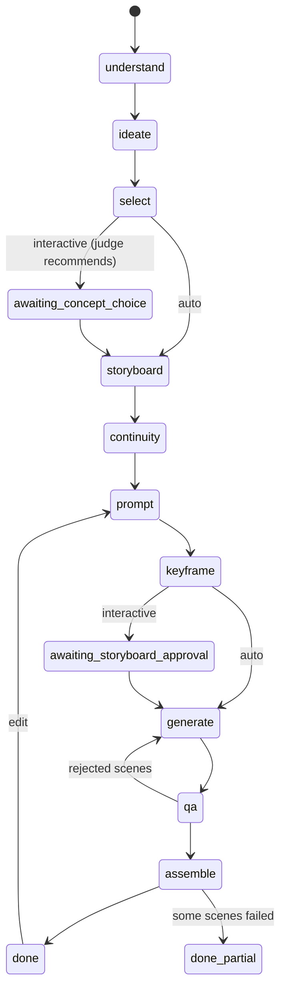
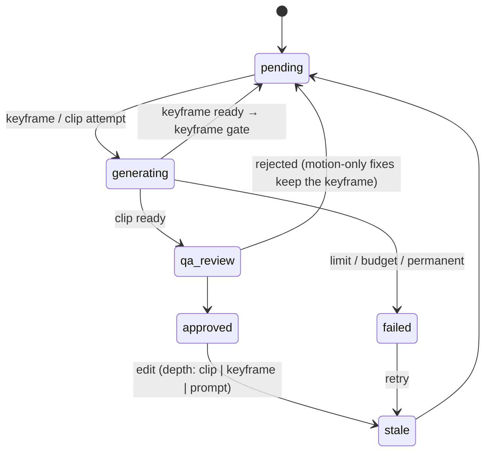

# Adsmith

**An ad agent with an explicit, typed, recoverable brain.** Ask for *"a 15-second ad for a luxury
men's perfume, cinematic"*, in English, Modern Standard Arabic or Saudi dialect. Adsmith writes
3 concepts, judges them, storyboards the winner with DP-level shot specs, writes prompts,
generates and checks keyframes and then clips, recovers from failures, and assembles the ad with
an Arabic end card. Change your mind with *"خل المشهد الثاني أبطأ"* ("make the second scene
slower") and only that scene's clip is regenerated. It runs with **zero API keys** (scripted LLM +
mock media), and it was tested on **real models** (Claude for reasoning, FLUX + LTX-2.3 + Kling v3
Pro on fal.ai for media).


<sub>Web studio after the edit *"make scene 3 at night"*: scenes 3–4 regenerate at prompt depth
(scene 4 because it continues the same moment), scenes 1–2 untouched at $0. More screenshots in
[docs/screenshots](docs/screenshots).</sub>

---

## Quickstart A: zero keys (≈2 minutes)

```bash
make setup        # uv sync, Python 3.12
make demo         # ~20 s: chaos run with recoveries → Arabic end card → an edit → kill + resume
uv run adsmith serve   # web studio at http://127.0.0.1:8000
```

`make demo` runs the Arabic perfume request with **Chaos Mode** on: injected transient errors,
content-policy rejections and QA failures, each recovered and labelled in the live trace. Then
it applies the edit *"خل المشهد الثاني أبطأ"* and prints the blast radius. Finally it kills a second
run with SIGKILL mid-generation and resumes it without paying twice.

## Quickstart B: real models

```bash
echo 'ANTHROPIC_API_KEY=sk-ant-...' >> .env
uv run adsmith run "سوّ لي إعلان 15 ثانية لعطر رجالي فاخر للشباب، بأسلوب سينمائي" --auto \
    --until keyframe                       # real planning, mock media (≈ $0.15, 90 s)

# optional real media (fal.ai). The wallet ceiling is mandatory:
echo 'FAL_KEY=...' >> .env
ADSMITH_LLM_PROVIDER=anthropic ADSMITH_MEDIA_PROVIDER=fal ADSMITH_FAL_BALANCE_USD=10 \
ADSMITH_BUDGET_USD=3 uv run adsmith run "<request>" --auto
```

Other commands: `choose`, `approve`, `edit`, `retry`, `resume [--from-version N]`, `assemble
[--partial slate]`, `trace [-f]`, `show`, `export`, `list`, `history`, `serve`.

---

## The brain

**The LLM reasons inside nodes; it never picks the next stage.** Stages and transitions are a
declared table, and `next_stage(state)` is a pure function. Nodes return **typed deltas**; one
writer applies them and persists a **snapshot after every step** (SQLite, WAL, optimistic
locking). Any run can be resumed, forked from a past version, or replayed, and every LLM call,
retry and recovery is a typed event in the trace.





Each scene has its own sub-state machine. Only a keyframe that passed the gate is ever animated:



## Error handling

| Failure | Recovery | Limit |
|---|---|---|
| Transient (5xx, timeout) / 429 | full-jitter backoff inside the attempt; honours `retry-after` | 4–5 tries |
| Content policy (provider or LLM refusal) | LLM rewrite that keeps product, shot and intent | 2 rewrites |
| Keyframe gate rejects the still | prompt revised from the critic's fixes, new seed, cache evicted, **before any video spend** | 3 tries |
| QA rejects the clip | revision with the critic's fixes; keyframe kept unless the still is wrong | 2 regens |
| Invalid LLM output | same-conversation schema repair with exact validation errors | 2 repairs |
| Budget would be exceeded | refused **before** the call; scene fails alone | run cap + wallet |
| Provider account refused (e.g. balance) | the whole run pauses (resumable), no further paid calls | — |

- **Scene isolation:** each scene is its own task with atomic commits; one failure never blocks
  or invalidates another, and assembly skips the failed scene (or shows a slate).
- **Cache:** the request hash covers model, prompt, params and input keyframe. Known-bad outputs
  are evicted, so a "retry" can never be served the rejected image.
- **Budget guard:** estimate → reserve → settle/release, per run *and* in a cross-run **wallet
  ledger** with a hard ceiling (real fal spend was capped at the prepaid $10).
- **Crash-safe resume:** interrupted attempts release their reservations. The fal **request id is
  persisted right after submit**, so resume polls the job that is already running instead of
  paying for it again (tested end to end by killing the process).
- **Chaos Mode:** deterministic, seeded fault injection; every injected fault is labelled.

## Targeted edits

The edit is parsed into a typed patch. The scene reference is resolved **by code** (Arabic and
English ordinals); a conflict check decides whether neighbours continue the same moment; and a
pure blast-radius function decides what goes stale and how deep:

| Edit | Blast radius | Provider calls | Untouched |
|---|---|---|---|
| خل المشهد الثاني أبطأ ("make the second scene slower") | S2, clip only, keyframe kept | 1 | S1, S3, S4: **0 calls** |
| make scene 3 at night | S3 prompt + S4 (continues the same moment) | 4 | S1, S2: **0 calls** |
| غيّر لبسه لثوب أسود ("change his outfit to a black thobe") | bible v2, scenes showing the character | ≈2 each | S4 product shot: **0 calls** |

Ambiguous edits ("غيّر شي", "change something") get a clarifying question, never a guess.

---

## What real runs taught me

I spent about $7 of real fal credit; these lessons changed the design.

1. **The curtain veil.** *"A curtain shadow drifts across the bottle"* was taken literally: LTX
   rendered a translucent curtain over the product. The vision critic rejected it (0.50); the QA
   loop rewrote the motion prompt from the critic's fixes and the next clip was clean.
   ([before](docs/media/curtain_before_rejected.mp4) → [after](docs/media/curtain_after_fixed.mp4))
   This led to two prompt rules: video models take nouns literally (describe light as light), and
   nothing goes between the camera and the product.
2. **Calibrating the critic took three tries.** First it was *too lenient*: a clip with 2 major
   issues passed at 0.72. Then it was *too strict*: 10 of 10 keyframes rejected for staging details.
   The fix was a **hard/soft split**: product identity, readability, stray text and brand safety
   fail a shot; light side, props and composition only lower the score (capped by code). Re-judging
   14 stored keyframes: **12 of 14 verdicts right**; the 2 misses were a round cap the critic can't see.
3. **Keyframe gate.** Most rejections were really about the *still*, found only after paying for a
   clip. Reviewing the still alone first stopped 21 keyframes before animation (≈ $0.56 of Kling
   each; ≈ $5.60 in the first full run alone).
4. **LTX-2.3 Fast vs Kling v3 Pro.** LTX: ~35 s and $0.36 per clip, but it veils passing shadows
   and its push-ins are faint. Kling: 4–8 min and $0.56 per clip, keeps the product crisp with real
   parallax, but ignores light-only actions and adds smoke when particles are mentioned.
5. **Single-take experiment.** Concepts designed around the model's strengths: one 10 s take, both
   gates passed first time, $1.43, and the product looked identical for the whole take
   ([video](docs/media/single_take_final.mp4)). But the judge picked the safest concept, and the
   promised beat (the bottle flying at the lens) never happened. It passed QA as a "soft" issue.
6. **What the critic missed (I caught these by eye):** a doorway appearing mid-clip, bottle shapes
   differing between scenes ([majlis ad](docs/media/majlis_ad_final.mp4)), and a bottle that reads
   like whisky. That last one is a brand-safety failure for a Saudi audience and should be a hard check.

## Design decisions

- Custom state machine over LangGraph: control flow is data, not prompts. [ADR-0001](docs/adr/0001-custom-state-machine-over-langgraph.md)
- Typed state; every LLM output is a validated schema. [0002](docs/adr/0002-typed-state-and-structured-outputs.md) · [0012](docs/adr/0012-llm-layer-structured-calls-and-repair.md)
- Keyframe-first, with a keyframe QA gate before any video spend. [0003](docs/adr/0003-keyframe-first-generation.md)
- Error taxonomy → one recovery strategy per kind. [0004](docs/adr/0004-error-taxonomy-and-recovery-strategies.md) · [0015](docs/adr/0015-scene-execution-media-gateway-chaos.md)
- Blast radius by invalidation depth. [0005](docs/adr/0005-blast-radius-and-invalidation-depth.md)
- Model per node, chosen by measurement. [0007](docs/adr/0007-model-selection-per-node.md)
- Zero-key, mock-first design. [0008](docs/adr/0008-mock-first-zero-key-design.md)
- Snapshots + events in SQLite with a single writer. [0011](docs/adr/0011-storage-and-write-concurrency.md) · [0013](docs/adr/0013-run-loop-typed-deltas-and-failure-handling.md)
- Creative guardrails (clichés, insight, product presence). [0014](docs/adr/0014-creative-quality-guardrails.md)
- Vision critic: code decides pass/fail, hard/soft severity. [0016](docs/adr/0016-vision-qa-critic.md)
- Video-model capability profiles and the single-take format. [0017](docs/adr/0017-video-capability-profiles-and-single-take.md)

## Limitations and "with more time"

- The keyframe model's layout adherence (light side, prop placement, product shape) is the main
  weakness. Next steps: a **product reference image** for generation and for the critic, and
  inpainting near-miss keyframes instead of re-rolling them.
- The critic is not deterministic and misses fine product identity. Next: a second opinion near the
  threshold, plus hard checks for geometry stability and alcohol resemblance.
- An escalation ladder: when the same failure repeats, switch model, then simplify the spec,
  instead of retrying the same request.
- Evals were cut for time. The full list is in [docs/MORE_TIME.md](docs/MORE_TIME.md).

## Repo map and quality gate

```
src/adsmith/domain/     Pydantic state, invariants, scene FSM      agent/       orchestrator, nodes, recovery, edit, QA
src/adsmith/providers/  Claude · scripted · fal · mock + adapters  storage/     snapshots, events, cache, wallet ledger
src/adsmith/api/        FastAPI + SSE + single page                cli/         Typer + Rich live trace, demo
src/adsmith/media/      frames, ffmpeg, Arabic end card            prompts/     versioned Jinja templates
config/                 models.toml (models, prices, profiles), chaos.toml, real_runs.toml
docs/                   PLAN · PROGRESS · ADRs · MORE_TIME · screenshots · media
```

`make check` = ruff + ruff format + **mypy --strict** + pytest: **455 tests** (2 live tests run
with `--live`). Recovery paths, edits, the wallet, crash/resume and the API all have tests.
