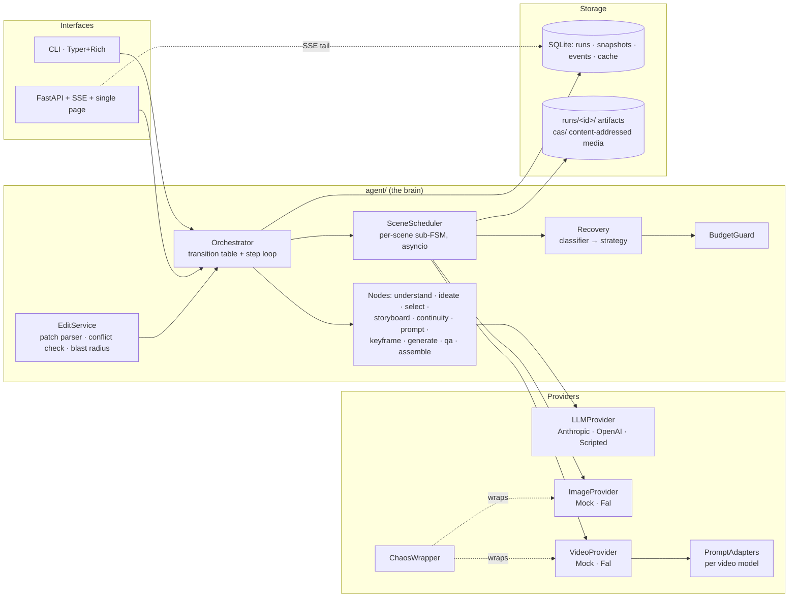
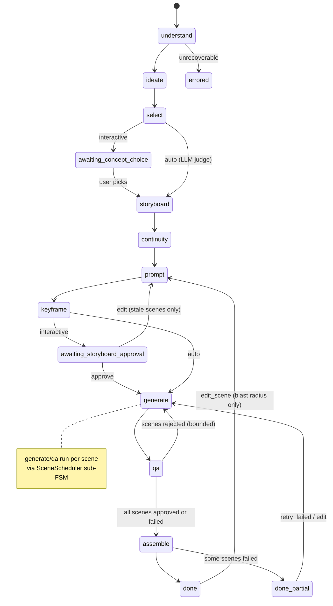
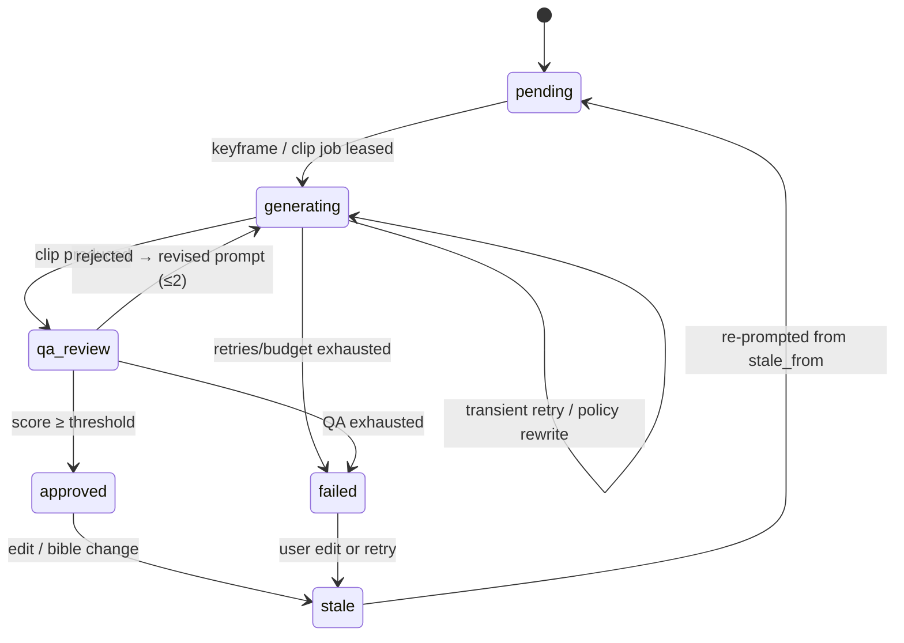

# "Adsmith": a marketing-ad agent with an explicit brain

> Status: **APPROVED (with revisions, 2026-11-04)**. This file becomes `docs/PLAN.md` in M0 and is kept up to date when anything changes.
>
> **Working mode:** after EACH milestone: run the quality gate → commit → update `docs/PROGRESS.md` → **stop** and give a short summary (what was built, key design choices and why, anything to understand before the next milestone) → wait for "continue".

## 0. Context

This is a take-home for an AI Engineer role. The task is a prototype agent that turns a natural-language ad request (English or Arabic, including Saudi dialect) into 3 concepts, a scene-by-scene storyboard, professional video-generation prompts, and finally a stitched 15-second ad. Failed scenes and targeted edits must be handled **without redoing the whole job**. The evaluators grade three things: **how the agent's brain is built, how its steps are organised, and how it handles errors**. So the plan spends most of its effort on the orchestrator, typed state, the recovery layer and the edit/blast-radius logic. UI polish comes last.

Environment facts (checked): `/Users/faisal/Q_job` is empty and not a git repo. `ffmpeg` is installed (`/opt/homebrew/bin/ffmpeg`). System Python is 3.14. **`uv` is not installed**, so M0 installs it, and uv then provides Python 3.12.

Model/endpoint facts (checked against current docs on 2026-11-04, not from memory; all of them live in config):
- Anthropic: per-node models chosen from **profiles** in `config/models.toml` (see §7.1 and ADR-0007). Default profile `balanced`: `claude-sonnet-5-5` with `claude-haiku-5-5` for `understand` and `edit_parser`. The `quality` profile uses `claude-opus-5-5` for `ideate`/`storyboard`. Structured output goes through `client.messages.parse(output_format=PydanticModel)` / `output_config.format`. Notes for current models: forced `tool_choice` (`any`/`tool`) returns 400; assistant prefill returns 400; `temperature`/`top_p` return 400 (API version 2026-10-21), so determinism comes from schemas and not sampling; set `output_config.effort` explicitly per node (defaults differ per model: Haiku 5.5 `medium`, Sonnet 5.5 `high`); structured-output support on each configured model gets confirmed with `client.models.retrieve()` during M3; always check `stop_reason == "refusal"` before reading content; vision input is image content blocks.
- fal.ai image-to-video: default `fal-ai/kling-video/v3/pro/image-to-video` (3–15 s, about $0.112/s with audio off). Alternatives in config: `bytedance/seedance-2.0/image-to-video` (param `image_url`, 4–15 s), `fal-ai/veo3.1/fast/image-to-video` (4/6/8 s). Parameter names differ per model (`image_url` vs `start_image_url`), which is one reason the adapter layer exists.
- fal.ai text-to-image (keyframes): default `fal-ai/flux/dev` (confirmed in fal docs), with `fal-ai/flux-2-flex` as an alternative. **Exact request/response schemas for both get re-verified against each model's API page during M11** before `FalProvider` is written. That step is recorded in the plan so no endpoint is trusted from memory.

---

## 1. Architecture overview

### 1.1 Key decision: lean custom state machine, not LangGraph

| Criterion | LangGraph | Custom state machine (chosen) |
|---|---|---|
| Linear run-level pipeline + human gates | Good (`interrupt`, checkpointer) | Good: ~150 LOC transition table |
| **Per-scene independent sub-state machines with partial invalidation** | Awkward: `Send` fan-out recomputes at the graph level, and partial re-entry of N sub-graphs after an edit needs custom state surgery anyway | Natural: each `Scene` carries its own status and `stale_from` marker, and a scheduler picks up whatever is not `approved` |
| Persistence model | Opaque checkpoint blobs keyed by thread; hard to query for "which scenes failed and why" | Our own SQLite schema: typed `RunState` JSON plus an append-only `events` table that the UI/CLI query directly |
| Debuggability in a code review | Control flow spread across framework internals and reducers | One `TRANSITIONS` table and one `step()` function; stack traces are ours |
| Testability | Needs graph harness | Pure function `next_stage(state) -> Stage`, nodes are `async (state, ctx) -> StateDelta`, all unit-testable |
| Dependency weight / version churn | Heavy, fast-moving API | Zero framework deps |

**Recommendation: custom.** The hard part of this assignment is not the linear graph. It is *scene-level* recovery and invalidation, and LangGraph gives no leverage there. A ~300-line orchestrator with a declared transition table is easier to defend, read and test. The README states what we give up (LangSmith tracing, built-in time travel) and how we cover it (our event trace plus snapshot-per-transition, which allows resume from any stage).

### 1.2 Component diagram



### 1.3 Run-level state machine



### 1.4 Scene-level sub-state machine



The phase is tracked separately (`keyframe | clip`) so `generating` is unambiguous. Statuses match the brief exactly: `pending | generating | qa_review | approved | failed | stale`.

**Control-flow principle:** the LLM never picks the next stage. Nodes return typed deltas, and `next_stage()` is a pure function of `RunState`. The LLM reasons *inside* nodes (ideation, critique, rewriting), and its outputs only ever fill schema fields.

---

## 2. File / folder tree

```
Q_job/
├── pyproject.toml                 # uv project, deps, ruff+mypy(strict)+pytest config
├── uv.lock
├── .env.example                   # every setting, no secrets
├── .gitignore                     # .env, runs/, cas/, *.db
├── README.md                      # quickstart A (zero keys) / B (Anthropic key), diagrams, error matrix, design decisions
├── CLAUDE.md                      # repo rules for AI-assisted work (<150 lines), see §13
├── docs/
│   ├── PLAN.md                    # this approved plan, kept current
│   ├── PROGRESS.md                # milestone log: built / decisions / deviations / tests / next
│   ├── DEMO_SCRIPT.md             # written last: scene-by-scene script for the 3–5 min video
│   └── adr/                       # Context / Decision / Alternatives considered / Consequences
│       ├── 0001-custom-state-machine-over-langgraph.md
│       ├── 0002-typed-state-and-structured-outputs.md
│       ├── 0003-keyframe-first-generation.md
│       ├── 0004-error-taxonomy-and-recovery-strategies.md
│       ├── 0005-blast-radius-and-invalidation-depth.md
│       ├── 0006-provider-abstraction-and-decorator-stack.md
│       ├── 0007-model-selection-per-node.md
│       └── 0008-mock-first-zero-key-design.md
├── config/
│   ├── models.toml                # profiles fast|balanced|quality → model+effort per node; fal endpoints; price table
│   └── chaos.toml                 # default chaos probabilities/seed
├── evals/                         # M12.5, lowest priority
│   ├── briefs.yaml                # 5 diverse requests (EN, MSA, Saudi; categories; durations)
│   └── run_evals.py               # metrics per brief → evals/report.md
├── prompts/                       # versioned templates (Jinja2, frontmatter: version, schema)
│   ├── understand/v1.md           # request → Brief (handles AR/Saudi dialect)
│   ├── ideate/v1.md               # Brief → 3 distinct concepts
│   ├── select/v1.md               # auto-pick judge with rubric
│   ├── storyboard/v1.md           # concept → scenes + shot specs, duration-constrained
│   ├── continuity/v1.md           # concept+scenes → ContinuityBible
│   ├── prompt_writer/v1.md        # scene+bible → provider-agnostic generation prompt
│   ├── edit_parser/v1.md          # NL edit → ScenePatch
│   ├── conflict_check/v1.md       # patch vs bible/neighbours → ConflictReport
│   ├── policy_rewrite/v1.md       # rejected prompt + reason → safe prompt, same intent
│   ├── qa_critic/v1.md            # frames + spec + bible → QAVerdict
│   └── schema_repair/v1.md        # invalid output + validation error → corrected JSON
├── src/adsmith/
│   ├── __init__.py
│   ├── config.py                  # pydantic-settings Settings; loads .env + config/*.toml
│   ├── logging.py                 # structlog JSON/console setup, run_id contextvar
│   ├── domain/
│   │   ├── enums.py               # Stage, SceneStatus, ShotType, CameraMove, FailureKind…
│   │   ├── brief.py               # Brief
│   │   ├── concept.py             # Concept, ConceptSet
│   │   ├── scene.py               # ShotSpec, Scene, SceneVersion
│   │   ├── storyboard.py          # Storyboard (+ duration invariants)
│   │   ├── continuity.py          # ContinuityBible
│   │   ├── generation.py          # GenerationRequest, GenerationAttempt, Artifact
│   │   ├── qa.py                  # QAVerdict, QAIssue
│   │   ├── edit.py                # ScenePatch, ShotSpecPatch, ConflictReport, BlastRadius
│   │   ├── events.py              # AgentEvent + typed payloads
│   │   ├── budget.py              # BudgetLedger
│   │   └── run.py                 # RunState (aggregate root), RunConfig
│   ├── agent/
│   │   ├── orchestrator.py        # TRANSITIONS, next_stage(), step(), run_until_blocked()
│   │   ├── context.py             # AgentContext: providers, store, budget, emitter, clock
│   │   ├── scheduler.py           # SceneScheduler: per-scene sub-FSM, concurrency semaphore
│   │   ├── structured.py          # structured_call(): LLM → validated model + repair loop
│   │   ├── nodes/
│   │   │   ├── understand.py
│   │   │   ├── ideate.py
│   │   │   ├── select.py
│   │   │   ├── storyboard.py
│   │   │   ├── continuity.py
│   │   │   ├── prompt.py
│   │   │   ├── keyframe.py
│   │   │   ├── generate.py
│   │   │   ├── qa.py
│   │   │   └── assemble.py
│   │   ├── recovery/
│   │   │   ├── errors.py          # exception taxonomy (AgentError subclasses)
│   │   │   ├── classifier.py      # provider exception/result → FailureKind
│   │   │   ├── policies.py        # RetryPolicy per kind (limits, backoff params)
│   │   │   ├── backoff.py         # exp backoff + full jitter (injectable sleep/rng)
│   │   │   └── strategies.py      # transient / policy_rewrite / qa_regen / exhausted
│   │   ├── budget.py              # BudgetGuard: estimate → reserve → commit/release
│   │   ├── export.py              # Production Pack: storyboard.md + storyboard.json (after `prompt`)
│   │   ├── i18n.py                # user-facing strings/messages in request language (ar/en)
│   │   └── edit/
│   │       ├── parser.py          # NL → ScenePatch (LLM) + deterministic scene-ref resolution
│   │       ├── conflicts.py       # rule checks + LLM conflict check
│   │       ├── blast_radius.py    # pure algorithm: patch → affected scenes + stale_from
│   │       └── service.py         # apply patch, version scenes, mark stale, re-enter FSM
│   ├── providers/
│   │   ├── llm/
│   │   │   ├── base.py            # LLMProvider Protocol, Message/ImagePart types
│   │   │   ├── anthropic.py       # messages.parse, refusal handling, usage → cost
│   │   │   ├── openai.py          # Responses API structured output equivalent
│   │   │   ├── scripted.py        # deterministic fixtures: tests + Quickstart A (LLM_PROVIDER=scripted)
│   │   │   └── fixtures/          # packaged canned perfume-ad outputs (EN + AR) for the zero-key demo
│   │   ├── media/
│   │   │   ├── base.py            # ImageProvider, VideoProvider Protocols, ProviderError types
│   │   │   ├── mock.py            # Pillow keyframes + ffmpeg clips, latency, failure injection
│   │   │   ├── fal.py             # fal_client queue submit/poll/result, upload keyframe
│   │   │   ├── chaos.py           # ChaosWrapper decorator (seeded RNG)
│   │   │   └── cache.py           # CachingProvider decorator: hash(prompt+params+provider)
│   │   └── adapters/
│   │       ├── base.py            # PromptAdapter: ScenePromptSpec → provider payload
│   │       ├── kling.py
│   │       ├── seedance.py
│   │       ├── veo.py
│   │       └── mock.py
│   ├── media/
│   │   ├── ffmpeg.py              # typed wrapper: run, probe, sample_frames, concat, overlay
│   │   └── endcard.py             # Pillow + arabic-reshaper + python-bidi → PNG → clip
│   ├── storage/
│   │   ├── db.py                  # sqlite3 (WAL), migrations, connection mgmt
│   │   ├── repo.py                # RunRepository: save_snapshot (optimistic version), load
│   │   ├── events.py              # EventStore: append, tail(since_seq)
│   │   └── artifacts.py           # run dirs + content-addressed store
│   ├── api/
│   │   ├── app.py                 # FastAPI factory, lifespan, background run tasks
│   │   ├── routes.py              # REST: runs, choose concept, approve, edit, retry, chaos
│   │   ├── sse.py                 # event stream w/ Last-Event-ID resume
│   │   └── static/index.html      # single polished page (vanilla JS, no build step)
│   └── cli/
│       └── main.py                # run · resume · choose · approve · edit · retry · trace · show · export · serve
└── tests/
    ├── conftest.py                # tmp db, scripted LLM, mock media, frozen clock, no-sleep
    ├── fixtures/llm/*.json        # canned structured outputs per node (tests)
    ├── unit/
    │   ├── test_domain_invariants.py
    │   ├── test_transitions.py
    │   ├── test_resume.py
    │   ├── test_structured_repair.py
    │   ├── test_recovery_transient.py
    │   ├── test_recovery_policy.py
    │   ├── test_recovery_quality.py
    │   ├── test_recovery_exhausted.py
    │   ├── test_scene_isolation.py
    │   ├── test_cache.py
    │   ├── test_budget.py
    │   ├── test_edit_parser.py
    │   ├── test_blast_radius.py
    │   ├── test_prompt_adapters.py
    │   └── test_backoff.py
    ├── integration/
    │   ├── test_e2e_mock.py       # full run with mock media + scripted LLM, assembles mp4
    │   ├── test_api_sse.py
    │   └── test_real_apis.py      # @pytest.mark.live, skipped unless keys + flag
```

---

## 3. Pydantic v2 schemas (field level)

All models use `model_config = ConfigDict(extra="forbid", frozen=False)` with `str_strip_whitespace=True`. IDs are `str` ULIDs. Times are UTC `datetime`. Bounded strings and lists use `Annotated[..., Field(max_length=…)]` so LLM output is validated on shape and size.

### Enums (`domain/enums.py`)
- `Stage`: `understand, ideate, select, awaiting_concept_choice, storyboard, continuity, prompt, keyframe, awaiting_storyboard_approval, generate, qa, assemble, done, done_partial, errored`
- `SceneStatus`: `pending, generating, qa_review, approved, failed, stale`
- `ScenePhase`: `keyframe, clip`
- `StaleFrom`: `prompt, keyframe, clip`. This is the invalidation depth: `prompt` regenerates everything, and `clip` keeps the keyframe and redoes only the video.
- `ShotType`: `extreme_wide, wide, medium_wide, medium, medium_close_up, close_up, extreme_close_up, insert, over_the_shoulder, pov`
- `CameraMove`: `static, pan, tilt, dolly_in, dolly_out, truck, pedestal, crane, orbit, handheld, gimbal_follow, push_in, pull_out, rack_focus, slow_motion`
- `FailureKind`: `transient, rate_limited, content_policy, quality_rejected, invalid_output, budget_exceeded, permanent, exhausted`
- `Language`: `en, ar`; `Dialect`: `msa, saudi_najdi, saudi_hijazi, gulf, other, none`

### `Brief`
`id`, `raw_request: str`, `language: Language`, `dialect: Dialect`, `product: str`, `product_category: str`, `brand_name: str | None`, `target_audience: str`, `tone: list[str]`, `visual_style: str`, `duration_s: float = 15` (5–60), `aspect_ratio: Literal["16:9","9:16","1:1"] = "9:16"` (config default, overridable by request), `must_include: list[str]`, `must_avoid: list[str]`, `tagline: str | None`, `tagline_language: Language`, `cultural_notes: list[str]` (e.g. Saudi market sensitivities), `assumptions: list[str]` (what the agent inferred, shown to the user), `normalized_request_en: str`.

### `Concept` / `ConceptSet`
`Concept`: `id`, `title`, `logline` (≤200), `narrative_arc: list[str]` (3–5 beats), `visual_hook`, `emotional_driver`, `differentiator: str` (why it is distinct from the others), `style_references: list[str]` (cinematographic descriptors, no real brands or people), `risk_notes: list[str]`, `estimated_scene_count: int` (2–6).
`ConceptSet`: `concepts: list[Concept]` (exactly 3), `selection_rationale: str | None`, `selected_id: str | None`, `selected_by: Literal["user","agent"] | None`.
A validator rejects near-duplicate concepts (title/logline similarity above a threshold), so "distinct" is enforced and not just hoped for. A rejection triggers a repair-retry with feedback.

### `ShotSpec`
`shot_type: ShotType`, `camera_movement: CameraMove`, `lens: str` (e.g. "85mm, f/1.8, shallow DoF"), `lighting: str`, `time_of_day: Literal["dawn","day","golden_hour","dusk","night","interior"]`, `composition: str`, `mood: str`, `subject_action: str`, `setting: str`, `color_notes: str | None`, `speed: Literal["normal","slow_motion","speed_ramp"] = "normal"`.

### `Scene`
- `id`, `order: int`, `duration_s: float` (1.5–8), `purpose: str` (hook/build/reveal/product/endcard)
- `description: str`, `shot: ShotSpec`
- `prompt: ScenePrompt | None`, where `ScenePrompt = {positive: str, negative: str, keyframe_prompt: str, motion_prompt: str, template_version: str, bible_version: int}`
- `status: SceneStatus`, `phase: ScenePhase`, `stale_from: StaleFrom | None`
- `keyframe: Artifact | None`, `clip: Artifact | None`, `qa: QAVerdict | None`
- `version: int`, `history: list[SceneVersion]`, where `SceneVersion = {version, shot, description, duration_s, prompt, reason, patch_id | None, created_at}`
- `attempts: list[GenerationAttempt]`
- `failure: SceneFailure | None`, where `SceneFailure = {kind: FailureKind, reason_user: str, reason_debug: str, at}`
- `content_hash() -> str`: a deterministic hash of the fields that affect generation

### `Storyboard`
`concept_id`, `scenes: list[Scene]` (2–6), `total_duration_s`. The validator enforces `abs(sum(durations) - brief.duration_s) <= 0.25`. Orders are contiguous, and scene IDs are stable across edits.

### `ContinuityBible`
`version: int`, `character: {description, age_range, ethnicity_appearance, hair, grooming, build, wardrobe: list[str]}`, `product: {name, bottle_shape, bottle_material, liquid_color, cap, label_text, label_style, distinctive_features: list[str], hero_angle}`, `color_grade: {palette: list[str] (hex), contrast, saturation, film_emulation}`, `location: {primary, secondary: list[str], era}`, `mood`, `lighting_baseline`, `audio_mood`, `forbidden: list[str]` (e.g. "no visible competitor brands", "modest wardrobe for KSA market"), `prompt_block() -> str` (the canonical text injected into every prompt).

### `GenerationAttempt`
`id`, `scene_id`, `phase: ScenePhase`, `attempt_no`, `provider: str`, `model: str`, `request_hash: str`, `prompt_used: str`, `params: dict[str, JsonValue]`, `started_at`, `finished_at`, `outcome: Literal["success","cache_hit","failed"]`, `failure_kind: FailureKind | None`, `error_message: str | None`, `recovery_action: Literal["retry_backoff","policy_rewrite","qa_regenerate","schema_repair","give_up"] | None`, `backoff_s: float | None`, `cost_usd: float`, `artifact: Artifact | None`, `qa_score: float | None`.

### `Artifact`
`kind: Literal["image","video","audio"]`, `path: str` (relative to the data dir), `sha256`, `width`, `height`, `duration_s | None`, `provider`, `remote_url | None`.

### `QAVerdict` / `QAIssue`
`QAVerdict`: `score: float` (0–1), `passed: bool`, `checks: {product_visible: bool, matches_shot_spec: bool, lighting_matches: bool, continuity_ok: bool, artifacts_free: bool, brand_safe: bool}`, `issues: list[QAIssue]`, `revised_prompt_hint: str`, `frames_inspected: int`.
`QAIssue`: `category: Literal["product","character","lighting","composition","motion","continuity","artifact","safety"]`, `severity: Literal["minor","major","blocker"]`, `observation`, `fix`.
`passed` is **recomputed deterministically** (score ≥ threshold and no blocker) and not trusted from the LLM.

### `ScenePatch` / `ShotSpecPatch` / `ConflictReport` / `BlastRadius`
- `ShotSpecPatch`: every `ShotSpec` field as `Optional`, `None` meaning unchanged.
- `ScenePatch`: `id`, `raw_instruction`, `language`, `targets: list[SceneRef]`, where `SceneRef = {kind: Literal["ordinal","id","relative","all"], value: str}` and `"relative"` covers phrases like "the last one" or "the one with the car". Also `shot: ShotSpecPatch`, `duration_s: float | None`, `description_change: str | None`, `bible_changes: dict[str, str] | None` (e.g. `{"character.wardrobe": "black thobe"}`), `confidence: float`, `clarification_needed: str | None`.
- `ConflictReport`: `conflicts: list[{with_: Literal["bible","prev_scene","next_scene","duration_budget"], scene_id | None, field, description, severity}]`, `suggested_resolution: Literal["apply_local","propagate_neighbors","update_bible","reject"]`.
- `BlastRadius`: `patch_id`, `affected: dict[scene_id, StaleFrom]`, `bible_bump: bool`, `duration_rebalance: dict[scene_id, float]`, `explanation: list[str]`.

### `AgentEvent`
`seq: int` (per run, monotonic), `run_id`, `ts`, `stage: Stage`, `scene_id | None`, `type: Literal["stage_started","stage_completed","llm_call","llm_repair","decision","attempt_started","attempt_finished","retry_scheduled","recovery","cache_hit","budget","scene_status","edit_parsed","blast_radius","awaiting_input","error","run_completed"]`, `summary: str` (a one-line, human-readable reasoning summary, never chain-of-thought), `payload: dict[str, JsonValue]` (inputs/outputs digest, prompt version, model, tokens, cost, latency), `level: Literal["info","warn","error"]`.

### `BudgetLedger`
`limit_usd`, `max_attempts_per_scene`, `max_total_attempts`, `spent_usd`, `reserved_usd`, `attempts_total`, `by_category: dict[Literal["llm","image","video"], float]`, `entries: list[{at, category, scene_id | None, est_usd, actual_usd, ref}]`.

### `RunState` (aggregate root, snapshotted)
`id`, `created_at`, `updated_at`, `state_version: int` (optimistic lock), `stage: Stage`, `config: RunConfig` (interactive, chaos, providers, qa threshold, budget, aspect, seed), `request: str`, `brief: Brief | None`, `concepts: ConceptSet | None`, `storyboard: Storyboard | None`, `bible: ContinuityBible | None`, `bible_history: list[ContinuityBible]`, `pending_patches: list[ScenePatch]`, `final: Artifact | None`, `budget: BudgetLedger`, `error: SceneFailure | None`.

---

## 4. State machine: stages, transitions, persistence, resume

**Run loop** (`orchestrator.py`):
```
async def run_until_blocked(run_id):
    state = repo.load(run_id)
    while state.stage not in TERMINAL | AWAITING:
        node = NODES[state.stage]
        emit(stage_started)
        delta = await node(state, ctx)          # pure-ish: returns StateDelta, may raise AgentError
        state = apply(state, delta)
        state.stage = next_stage(state)         # pure function, table-driven
        repo.save_snapshot(state)               # PERSIST after every transition
        emit(stage_completed)
```
- `TRANSITIONS: dict[Stage, Callable[[RunState], Stage]]`. Guards are explicit (for example `generate → qa` always; `qa → generate` iff any scene is in `pending/stale` and under its attempt cap; `qa → assemble` iff all scenes are `approved | failed`).
- **Human gates:** `awaiting_concept_choice` and `awaiting_storyboard_approval` are persisted stages. The loop exits and a later command (`choose`, `approve`, `edit`) mutates state and calls `run_until_blocked` again. With `interactive=false` (CLI `--auto`, tests), `select` uses the LLM judge and keyframe approval is automatic.
- **Persistence points:** (1) after every run-level transition, (2) after every scene status change inside `generate`/`qa`/`keyframe`. The scheduler sends scene results through a single writer (an `asyncio.Lock` in `RunRepository`), so concurrent scenes never clobber each other, (3) after every edit application. Snapshots go in an append-only `snapshots(run_id, state_version, stage, json, ts)` table, and `runs` points at the latest. This gives inspection of any past stage and `resume --from-version N` (forks a new run).
- **Resume semantics:** load the latest snapshot, then re-enter `stage`. Nodes are **idempotent**: run-level nodes skip if their output already exists, and scene work is resumable because (a) any scene left `generating` from a crash is reset to `pending` (lease recovery), and (b) the content-addressed cache means a clip that completed but was never recorded is a cache hit, not a re-spend. `stale` scenes resume from their `stale_from`.
- **Errors at run level** (for example `understand` fails after schema repairs): the run goes to `errored` with a reason, and `resume` retries that stage.

---

## 5. Error taxonomy → recovery

Exceptions (`recovery/errors.py`): `AgentError` → `TransientProviderError`, `RateLimitedError(retry_after)`, `ContentPolicyError(reason, field)`, `QualityRejectedError(verdict)`, `InvalidLLMOutputError(validation_errors, raw)`, `BudgetExceededError`, `PermanentProviderError`. `classifier.py` maps SDK exceptions to these: Anthropic typed errors (`RateLimitError`, `APIConnectionError`, `APITimeoutError`, `InternalServerError`, `stop_reason=="refusal"`), fal HTTP status codes and error bodies, and httpx timeouts.

| Failure | Detection | Recovery strategy | Limit (configurable) |
|---|---|---|---|
| Transient (5xx, timeout, connection) | classifier | Exponential backoff, **full jitter**: `sleep = rng.uniform(0, min(cap, base·2^n))`, base 1 s, cap 20 s | 4 attempts per call |
| Rate limited (429) | classifier | Honour `retry-after` if present, else the backoff above. A shared per-provider token gate stops the other scenes from stampeding | 5 attempts |
| Content-policy rejection (video/image provider, or LLM refusal) | provider error code / `stop_reason=refusal` | `policy_rewrite` LLM node: input is the prompt, provider reason and bible; output is a `PolicyRewrite{prompt, removed_elements, intent_preserved_rationale}`. A deterministic check ensures the product and shot spec are still present | 2 rewrites per scene-phase |
| Quality failure (QA critic rejects) | `QAVerdict.passed == False` | Regenerate with `prompt_writer` in *revision mode*: prior prompt + `issues[].fix` + `revised_prompt_hint`. Keyframe kept unless an issue category is `product/character/composition` (then `stale_from=keyframe`) | 2 regenerations per scene |
| Invalid LLM output | Pydantic `ValidationError` / JSON decode / truncated (`max_tokens`) | `structured_call` repair loop: re-ask with the original messages + invalid output + the exact validation errors (`schema_repair` template). On `max_tokens`, retry with a higher limit | 2 repairs per call |
| Budget would be exceeded | `BudgetGuard.reserve(est)` fails | No call is made. Scene → `failed(kind=budget_exceeded)`. Remaining scenes are not started, and finished ones are kept | `limit_usd` per run (**default $10**), `max_attempts_per_scene=6`, `max_total_attempts` |
| Permanent (4xx bad request, auth) | classifier | No retry, mark failed with a clear reason (auth errors abort the run with a fix hint) | 0 |
| Exhausted | any limit hit | Scene → `failed`, `SceneFailure.reason_user` in plain language (in the user's language). Others continue; `assemble` produces `done_partial` with a slate for the failed slot, or skips it if configured. `retry <scene>` / edit re-arms it | — |

Isolation guarantees:
- Each scene runs as its own `asyncio` task under a semaphore (default 3). Exceptions are caught at the scene boundary and converted into `SceneFailure`, and nothing propagates to the gather. This uses `asyncio.gather(..., return_exceptions=True)` plus explicit handling, with an explicit test that one scene failing leaves the others `approved`.
- **Idempotency/cache:** `request_hash = sha256(canonical_json({provider, model, phase, prompt, negative, params, input_image_sha256}))`. `CachingProvider` checks the `cache` table first. A hit returns the artifact and logs a `cache_hit` event at zero cost. Failures are never cached.
- **Budget:** price table in `config/models.toml` (LLM $/Mtok in and out, image $/image, video $/s per endpoint). The flow is estimate → `reserve` → call → `commit(actual)` or `release`. The UI shows spent and reserved against the limit.

**Chaos Mode** (`ChaosWrapper`): a seeded RNG. Per attempt it injects `transient` (p=0.25), `policy` (p=0.15) or `quality` (p=0.15; this forces the mock critic to reject with concrete issues). `first_attempt_only=true` by default so the demo always shows recovery and then success. It can be toggled per run from the UI or CLI. Every injected fault is logged as `chaos_injected` in the event payload, so the trace is honest about it.

---

## 6. Scene-edit flow and blast-radius algorithm

Flow (`edit/service.py`):
1. **Parse:** `edit_parser` LLM call turns the NL text (EN/AR/Saudi) into a `ScenePatch`. Scene references are resolved **deterministically** after the LLM: Arabic ordinals (`الأول، الثاني، الثالث، الأخير`, plus digits) and English ("scene 3", "last", "the opening") are mapped by a lookup table. "Relative" refs are resolved by the LLM against scene descriptions and confirmed against the ID list. If `confidence < 0.6` or `clarification_needed` is set, the agent asks back instead of guessing.
2. **Conflict check:** first, deterministic rules (duration-sum invariant; `time_of_day` jump versus neighbours without a narrative cut; wardrobe/location differing from the bible). Then an LLM `conflict_check` for semantic conflicts (for example "make scene 3 at night" when scene 4 continues the same action in daylight). Output: `ConflictReport` with a suggested resolution. In interactive mode the user picks `apply_local | propagate | update_bible`; in auto mode the suggestion is used.
3. **Blast radius** (pure function, heavily tested):
```
def compute_blast_radius(sb, bible, patch, conflicts, resolution) -> BlastRadius:
    affected = {}
    for s in resolve_targets(patch):
        affected[s.id] = depth_for(patch)                 # see field table
    if patch.duration_s is not None:
        rebal = rebalance_durations(sb, patch, total=brief.duration_s)  # proportional, respects min/max
        for sid, d in rebal.items(): affected.setdefault(sid, CLIP)     # duration only → keep keyframe
    if resolution == PROPAGATE:
        for c in conflicts where c.with_ in {prev_scene,next_scene}:
            affected[c.scene_id] = max(affected.get(c.scene_id), PROMPT)
    if patch.bible_changes or resolution == UPDATE_BIBLE:
        bible_bump = True
        for s in sb.scenes:
            if bible_field_used_by(s, changed_fields): affected[s.id] = PROMPT   # e.g. wardrobe change skips product-only inserts
    return BlastRadius(...)
```
   Field → invalidation depth table:
   - `camera_movement`, `speed`, `duration` → **`clip`** (keyframe still valid; only motion changes)
   - `lighting`, `time_of_day`, `shot_type`, `lens`, `composition`, `setting`, `description`, `subject_action`, `mood` → **`prompt`** (re-prompt, new keyframe, new clip)
   - bible changes → **`prompt`** for each scene that references the changed bible section
4. **Apply:** for each affected scene, push a `SceneVersion` to history, apply the patch, set `status=stale` with `stale_from`, and bump `bible.version` if needed. Then set the run stage to `prompt` (or `generate` if every `stale_from` is `clip`) and call `run_until_blocked`. Untouched scenes stay `approved`, and the cache guarantees they are not regenerated even if something re-enters them.
5. **Trace:** `edit_parsed`, `blast_radius` (with the `explanation` list, e.g. "scene 4 affected: continues action from scene 3 in daylight") and per-scene status events.

Examples to put in the README and tests: "make scene 3 at night" → S3 prompt-depth, plus S4 if a conflict is propagated. "خل المشهد الثاني أبطأ" ("make the second scene slower") → S2 `speed=slow_motion` at clip depth, keyframe kept. "change his outfit to a black thobe in all scenes" → bible bump, prompt depth for every scene showing the character, product inserts untouched.

---

## 7. Prompt design strategy per LLM node

Shared conventions: templates are Jinja2 files with YAML frontmatter `{name, version, output_schema, model_key, effort}`. The system prompt states the role and constraints, user content carries the data in XML-tagged sections (`<brief>`, `<bible>`, `<scene>`), and the output is always a Pydantic schema via `messages.parse` (Anthropic) or `responses.parse` (OpenAI). Each schema field has a `description`, since that is part of the prompt. Every LLM event records the template name and version. No sampling params (rejected on the current API); variety comes from instructions, schema constraints and the distinctness validator. The model and effort per node come from the active profile (§7.1).

**Language rule:** all *user-facing* text (concept titles/loglines, storyboard descriptions, failure reasons, clarification questions, conflict explanations) follows `Brief.language`: Arabic in, Arabic out. Schemas carry these as user-language fields. Every *generation-facing* field (`ScenePrompt.*`, `ShotSpec` text fields, bible) is **always English**, because video models perform best in English. Templates get a `{{ user_language }}` variable, and a validator checks script consistency (Arabic code points present when `language=ar`). Deterministic messages (exhausted retries, budget) come from `agent/i18n.py`.

### 7.1 Model profiles (`config/models.toml`, ADR-0007)

| Node | `fast` | `balanced` (default) | `quality` | Reasoning |
|---|---|---|---|---|
| understand | haiku-5-5 / low | **haiku-5-5 / medium** | sonnet-5-5 / medium | Extraction plus dialect normalisation is narrow; latency matters at the very first step |
| ideate | sonnet-5-5 / low | sonnet-5-5 / high | **opus-5-5 / high** | Creative breadth and distinctness is where model quality shows most |
| select (judge) | haiku-5-5 / low | sonnet-5-5 / medium | sonnet-5-5 / high | Rubric scoring; the argmax is in code |
| storyboard | sonnet-5-5 / low | sonnet-5-5 / high | **opus-5-5 / high** | Hardest planning step: durations, producibility, cinematography |
| continuity | haiku-5-5 / medium | sonnet-5-5 / medium | sonnet-5-5 / high | Mostly extraction from concept and scenes |
| prompt_writer | sonnet-5-5 / low | sonnet-5-5 / medium | sonnet-5-5 / high | Runs once per scene, so volume makes cost matter |
| edit_parser | haiku-5-5 / low | **haiku-5-5 / medium** | sonnet-5-5 / medium | Interactive latency; narrow schema; deterministic ref resolution backs it up |
| conflict_check | haiku-5-5 / medium | sonnet-5-5 / medium | sonnet-5-5 / high | Semantic reasoning over neighbours |
| policy_rewrite | sonnet-5-5 / low | sonnet-5-5 / medium | sonnet-5-5 / medium | Must keep intent; low volume |
| qa_critic (vision) | sonnet-5-5 / low | sonnet-5-5 / medium | opus-5-5 / medium | Runs once per clip attempt; vision |
| schema_repair | inherits the failing node's model | | | Same context, so same model |

Every model is overridable per node (`ADSMITH_MODEL__STORYBOARD=claude-opus-5-5`). Prices live in the same file, so the budget guard and the ADR quote the same numbers.

| Node | Strategy |
|---|---|
| **understand** | Bilingual instructions with explicit Saudi-dialect glossary hints (e.g. أبغى/أبي = I want, خل = make/let, مره = very, زي = like). Output an English-normalised Brief **plus** the detected language, so user-facing text can be answered in Arabic. Every inference goes into `assumptions` and is never silently invented. Includes market and cultural guardrails (modesty, no alcohol cues, etc.) in `cultural_notes`. Effort: low. |
| **ideate** | Asks for 3 concepts along deliberately different axes (e.g. narrative / sensory-abstract / aspirational-lifestyle), each with a stated `differentiator`. Includes the brief's style and audience. Distinctness is validated in code and repaired with feedback if it fails. Effort: high. |
| **select** (auto mode) | LLM-as-judge with an explicit weighted rubric (brief fit, producibility with current video models in ≤15 s, product hero time, cultural fit, distinctiveness). Output scores per concept plus a rationale. The code picks the argmax, so selection is deterministic given scores. |
| **storyboard** | A shot-list expert persona with a cinematography vocabulary restricted to the enums. Hard constraints in prompt and validator: durations sum to target, each scene 1.5–8 s and within the video model's duration range (from config), the product appears in ≥ N scenes, and the last scene is a product hero. A provider-capability block (supported durations, no text rendering, max motion complexity) is injected so the plan is *producible*. |
| **continuity** | Extracts a concrete, visual-only bible (no adjectives without nouns: "matte black faceted glass bottle, brushed-gold cap", not "luxurious"). Hex palette. A `forbidden` list derived from the brief and cultural notes. |
| **prompt_writer** | Turns scene + bible into a **provider-agnostic** `ScenePrompt` with fixed slot order: subject → action → setting → camera (shot, lens, movement) → lighting → color grade → mood → bible block → negatives. Separate `keyframe_prompt` (static composition) and `motion_prompt` (camera move + subject action only, since image-to-video models do best when the image already carries the look). Revision mode adds `<qa_feedback>` and must address each issue. |
| **Prompt adapters** (code, not LLM) | `KlingAdapter`, `SeedanceAdapter`, `VeoAdapter`, `MockAdapter` map `ScenePrompt` + duration onto each model's payload: param names (`image_url` vs `start_image_url`), duration snapping to allowed values, negative-prompt support or folding, length limits and keyword ordering. Unit-tested with golden payloads. |
| **edit_parser** | Few-shot examples in EN, MSA and Saudi dialect covering ordinals, relative refs, multi-scene and bible-level edits. Must emit `clarification_needed` instead of guessing. Effort: low. |
| **conflict_check** | Given the patch, the target, its neighbours and the bible, list concrete conflicts with a severity and suggest a resolution. |
| **policy_rewrite** | Given the provider's rejection reason, remove or neutralise the triggering elements (e.g. skin exposure, weapon-like props, real-person likeness) and keep the product, shot spec and emotional intent. Returns `removed_elements` for the trace. |
| **qa_critic** | Vision input: 3 frames sampled at 15/50/85% of the clip plus the keyframe, spec, bible and checklist. Scores each check, cites the frame index for each issue, and gives actionable `fix` text phrased as prompt edits. In mock mode a `MockCritic` is used by default (placeholder frames would always fail a real critic). It passes unless chaos injects a quality fault. `QA_MODE=llm` forces the real critic. |
| **schema_repair** | Short template: "your previous output failed validation: <errors>. Return a corrected object only." Includes the raw previous output. |

---

## 8. Provider interfaces and the mock design

```python
class LLMProvider(Protocol):
    name: str
    async def structured(self, *, system: str, messages: Sequence[LLMMessage], schema: type[T],
                         model: str, effort: Effort, max_tokens: int) -> StructuredResult[T]: ...
    # StructuredResult: parsed: T | None, raw_text, stop_reason, usage(in,out), cost_usd, latency_ms
    # raises classified AgentError subtypes; never returns unvalidated data

class ImageProvider(Protocol):
    name: str
    async def generate_image(self, req: ImageRequest) -> Artifact: ...

class VideoProvider(Protocol):
    name: str
    capabilities: VideoCapabilities   # allowed durations, aspect ratios, supports_negative, max_prompt_chars
    async def image_to_video(self, req: VideoRequest) -> Artifact: ...
```
- `AnthropicProvider`: `messages.parse(output_format=Schema)`, `output_config.effort`, refusal → `ContentPolicyError`, and the SDK's internal retries are disabled (`max_retries=0`) so **our** recovery layer owns retries and the trace sees them. Images are sent as base64 image blocks for the QA critic.
- `OpenAIProvider`: the same Protocol via the OpenAI SDK's structured-output parse. The model ID comes from config and is verified against the OpenAI docs at implementation time.
- `ScriptedLLMProvider`: returns fixtures keyed by `(template_name, call_index)` and can inject invalid JSON or refusals. Used by all unit tests and, optionally, a zero-key demo (see open questions).
- `MockImageProvider`: a Pillow 1280×720 (or aspect-matched) card. The background colour is derived from the bible palette and `time_of_day`, with large scene number, shot type, camera move, lens and a truncated prompt drawn on it. Deterministic from the request hash.
- `MockVideoProvider`: ffmpeg takes the keyframe and applies `zoompan`/crop motion that matches `camera_movement` (dolly_in → zoom in, pan → x-offset, static → still), adds a drawtext overlay "S3 · v2 · attempt 1" and runs for exactly `duration_s` at 24 fps. Configurable `latency_s` (default 1.5 s, so the live UI is visible) and `failure_rate` per kind (also driven by ChaosWrapper).
- `FalImageProvider` / `FalVideoProvider`: `fal_client` async queue submit → poll status → fetch result → download to CAS. The keyframe is uploaded with `fal_client` upload. HTTP status and error bodies are mapped via the classifier. Endpoint and params come from config plus the adapter.
- Decorator stack (composition, not inheritance): `CachingProvider(ChaosWrapper(BudgetMeter(Fal|Mock)))`. Cache is outermost, so a cache hit costs nothing and skips chaos.

**Assembly** (`assemble` node + `media/ffmpeg.py`): normalise every approved clip (fps, resolution, SAR, pixel format), concat with the concat demuxer (optional 6-frame crossfade via `xfade`), then append the end-card. The end-card is a Pillow PNG with brand and tagline; Arabic is shaped with `arabic-reshaper` + `python-bidi` and rendered with a bundled OFL Arabic font (e.g. Noto Naskh Arabic, licence included), because ffmpeg `drawtext` can't shape Arabic without libraqm. Optional music: **user-supplied path only** (`--music path.mp3` / UI upload; nothing bundled, to avoid licensing issues), with `-stream_loop`, trim and a fade-out. Failed scenes get a "scene unavailable" slate in `done_partial` mode (configurable: `slate | skip`). The total-duration check runs after assembly.

---

### 8.1 Production Pack export
After the `prompt` stage, and again after every edit or re-prompt, `agent/export.py` writes `runs/<id>/production_pack/`:
- `storyboard.json`: brief, selected concept, bible, and per scene the full `ShotSpec`, duration, keyframe/motion/negative prompts, status, and keyframe/clip paths if they exist (a Pydantic dump, schema-versioned).
- `storyboard.md`: a human-readable shot list. Header (brief, concept, bible summary), then per scene: order, duration, shot type, lens, camera move, lighting, composition, mood, action, keyframe prompt, motion prompt, negative prompt, and the keyframe image link if present. User-facing text is in the request language; prompts are in English.

It exists even if video generation is skipped, fails or runs out of budget. That makes the agent useful as a pre-production tool with an external crew or video tool. Access: `adsmith export <run> [--out DIR]` and a download button (zip) in the UI (`GET /runs/{id}/production-pack.zip`). Tested in `test_export.py`.

## 9. Test plan

All unit tests run offline: `ScriptedLLMProvider`, mock media, `FakeClock`, and `sleep` injected as a no-op that records delays.
- **State transitions:** a table-driven test of `next_stage` for every stage and guard; illegal transitions raise.
- **Resume:** run to `keyframe`, simulate a crash by cancelling mid-generate with a scene left `generating`, then reload and resume. Assert no duplicate spend (cache hits counted) and the final state equals an uninterrupted run. Also resume from each human gate, and `--from-version` fork.
- **Recovery paths** (each via mock failure injection):
  - transient → retries with expected backoff sequence (seeded RNG) → success; exhausted → `failed(transient)`
  - rate-limited honours `retry_after`
  - policy → `policy_rewrite` called with reason → success; the rewritten prompt still contains the product; exhausted after 2
  - quality → critic feedback appears in the revised prompt; keyframe reuse vs regen depends on issue category
  - invalid LLM output → repair prompt contains the validation errors → success; double failure → `InvalidLLMOutputError` surfaced as a run-level `errored`
  - budget → reservation refused, no provider call made, scene failed, others intact
- **Scene isolation:** scene 2 permanently fails while 1, 3 and 4 are approved; the run ends `done_partial` with the clip assembled.
- **Blast radius:** a parametrised matrix (local camera change; time-of-day with/without propagate; duration change → rebalance at clip depth; bible wardrobe change skips product-only inserts; multi-target). Pure-function tests plus a property test (Hypothesis) that unaffected scenes keep the same `content_hash`.
- **Scene-patch parsing:** fixtures for EN/MSA/Saudi inputs → expected `ScenePatch`; deterministic ordinal resolution for Arabic and English words; low-confidence → clarification.
- **Cache:** same request → one provider call; changed prompt → miss; failures not cached; after an edit, unaffected scenes produce zero provider calls.
- **Adapters:** golden payloads per video model, duration snapping.
- **Structured call:** refusal → `ContentPolicyError`; `max_tokens` truncation → retried with a higher limit.
- **Integration:** e2e mock run produces an mp4 whose ffprobe duration is ≈ 15 s (± end-card config). API + SSE test via `httpx.AsyncClient`. `tests/integration/test_real_apis.py` is marked `live` and runs only with `--live` and the keys present (one real Anthropic structured call plus one fal keyframe).
- CI-style gate: `uv run ruff check && uv run ruff format --check && uv run mypy --strict src tests && uv run pytest`.

---

## 10. Milestones (build order; each one runnable and committed)

| # | Milestone | Deliverable / how to run | Est. |
|---|---|---|---|
| M0 | Scaffold + docs | `brew install uv`, `git init`, py3.12 via uv, deps, ruff/mypy/pytest config, `.env.example`, settings (profiles, 9:16 default, $10 budget), logging, **CLAUDE.md**, `docs/PLAN.md`, `docs/PROGRESS.md`, ADRs 0001–0008 drafted from this plan (each refined in the milestone that implements it). Quality gate green on an empty test. Commit `chore: scaffold project and docs` | 25m |
| M1 | Domain schemas | All Pydantic models, enums, invariants and validators, plus tests. `feat(domain): typed agent state` | 35m |
| M2 | Storage + events | SQLite (WAL), snapshots, event store, artifacts/CAS, repo with optimistic lock, plus tests. `feat(storage): …` | 25m |
| M3 | LLM layer | `LLMProvider`, Anthropic + Scripted (+ OpenAI skeleton), `structured_call` with repair loop, prompt-template loader, plus tests | 35m |
| M4 | Orchestrator + planning nodes | Transition table, `run_until_blocked`, understand → ideate → select → storyboard → continuity → prompt with templates, human gates, resume, language rule, **Production Pack export**, packaged scripted fixtures (EN+AR). CLI stub `adsmith run --auto` with `LLM_PROVIDER=scripted` prints the storyboard and writes the pack | 65m |
| M5 | Media + recovery core | Mock image/video, adapters, cache, ChaosWrapper, budget guard, error taxonomy/classifier/backoff/strategies, SceneScheduler, keyframe + generate nodes, plus all recovery tests | 65m |
| M6 | QA critic | Frame sampling, LLM critic + MockCritic, QA regenerate loop, plus tests | 20m |
| M7 | Edits | Edit parser, deterministic ref resolution, conflict check, blast radius, apply/re-enter, plus tests | 40m |
| M8 | Assembly | Concat, end-card (Arabic shaping), music, partial mode, e2e mock test → **first full 15 s ad** | 15m |
| M9 | CLI | `run, resume, choose, approve, edit, retry, trace (Rich live table), show, export, chaos, serve` | 15m |
| M10 | Web UI | FastAPI routes, SSE with Last-Event-ID, single page: request box, 3 concept cards, storyboard timeline with keyframes and live status chips, per-scene edit box, trace panel, chaos toggle, budget meter, Production Pack download, video player; RTL-aware rendering for Arabic text | 40m |
| M11 | Fal provider | Verify endpoint schemas in fal docs (Kling v3 Pro default), implement `FalImageProvider`/`FalVideoProvider`, live test | 20m |
| M12 | README + polish | Quickstart A (zero keys) + B (Anthropic key, optional fal), diagrams, error matrix, design decisions → ADR links, limitations, "more time" list | 20m |
| M12.5 | Evals *(first to cut)* | `evals/briefs.yaml` (5 briefs: EN, MSA, Saudi; perfume, coffee, car, fintech app, abaya; 10/15/30 s), `run_evals.py` → `evals/report.md` with: schema validity, repair attempts, concept distinctness score, duration-invariant pass, product-in-scene coverage, latency, cost | 25m |
| M13 | Demo script | `docs/DEMO_SCRIPT.md`: scene-by-scene for the 3–5 min explanation video | 10m |
| | **Total** | | **≈ 7h 30m** (≈ 6h 55m without M12.5) |

If time runs short, cut in this order: **M12.5 evals**, OpenAI provider (skeleton only), crossfades, UI polish (functional before pretty), Hypothesis property test. Nothing in M1–M8 gets cut.

Each milestone ends with: quality gate → conventional commit(s) → `docs/PROGRESS.md` entry (built / key decisions / deviations / test results / next) → any new or changed ADR → **stop for review**.

---

## 11. Risks and mitigations

| Risk | Mitigation |
|---|---|
| Real video models produce inconsistent product/character across scenes | Keyframe-first + bible block in every prompt + QA continuity check; documented as a known limitation, with reference-image conditioning (product photo) as "more time" |
| fal endpoint schemas drift / differ per model | Adapters + config-driven endpoints; verify at M11; live test catches drift |
| ffmpeg `drawtext` can't shape Arabic | Pillow + arabic-reshaper + python-bidi + bundled font for any Arabic text |
| Real QA critic always fails mock placeholder frames | `MockCritic` default in mock mode; `QA_MODE=llm` explicit |
| Concurrency corrupting state | Single-writer repo lock + optimistic `state_version`; scenes return results, never write directly |
| LLM non-determinism makes tests flaky | All unit tests use `ScriptedLLMProvider`; real LLM only in the opt-in live test |
| Model API constraints (no temperature, no forced tool choice, no prefill on `claude-opus-5-5`) | Structured outputs via `messages.parse`; variety via instructions; documented in README |
| Cost blow-up with real video | BudgetGuard reserve-before-call, per-scene attempt caps, cache, keyframe approval gate before any video spend |
| `uv` not installed / Python 3.14 system default | Install uv in M0; `uv python install 3.12`; `.python-version` pin |
| 6-hour scope | Brain-first milestone order, explicit cut list |

---

## 12. Resolved decisions (from review)

1. Zero-key mode supported: **Quickstart A** = `LLM_PROVIDER=scripted` + mock media (no keys at all); **Quickstart B** = Anthropic key (+ optional fal key). ADR-0008.
2. Models: default `claude-sonnet-5-5`, `claude-haiku-5-5` for `understand`/`edit_parser`, Opus selectable per node; profiles `fast | balanced (default) | quality`. ADR-0007.
3. User-facing text follows the request language (Arabic in, Arabic out); generation prompts are always English.
4. The human picks the concept by default (UI/CLI); `--auto` uses the LLM judge.
5. Default aspect ratio 9:16, configurable.
6. fal default video model: Kling v3 Pro (`fal-ai/kling-video/v3/pro/image-to-video`); default budget cap $10/run.
7. No bundled music; user-supplied path only.
8. Install uv via Homebrew and `git init`: approved.
9. Package name `adsmith`.
10. Arabic text in source, fixtures and prompts is stored in **logical order** (checked by code point; reversed display was only terminal bidi rendering). A unit test asserts that Arabic fixtures start with the expected first letter in logical order, and editors are never used to "fix" visual order.

## 13. CLAUDE.md (repo root, created in M0, under ~150 lines)
- Purpose (3 lines) + pointers to `docs/PLAN.md`, `docs/adr/`, `docs/PROGRESS.md`.
- Commands: setup (`uv sync`), run (`uv run adsmith run …`, `serve`), test (`uv run pytest`), lint (`uv run ruff check . && uv run ruff format --check .`), typecheck (`uv run mypy --strict src tests`), full gate (`make check`, which chains all of them).
- Architecture rules: the LLM never decides control flow; all state changes go through typed deltas + the orchestrator; scenes never write state directly; no model IDs or endpoints outside `config/`; prompts live only in `prompts/` as versioned templates; provider SDK retries disabled, since the recovery layer owns retries.
- Code standards: Python 3.12, full type hints, `mypy --strict`, ruff, Pydantic v2 `extra="forbid"`, no bare `except`, every recovery path has a test.
- Workflow: quality gate before every commit; conventional commits; update `docs/PROGRESS.md` per milestone; ADR for any architectural change; stop after each milestone for review.

---

## Verification (end to end, after build)
1. `uv run pytest` → all unit + integration (mock) tests pass; `ruff` + `mypy --strict` clean.
2. `uv run adsmith run "اعطني إعلان ١٥ ثانية لعطر رجالي فاخر يستهدف الشباب بأسلوب سينمائي" --auto --chaos` (Arabic: "Give me a 15-second ad for a luxury men's perfume targeting young people, in a cinematic style"). Watch the Rich trace show transient retries, a policy rewrite and a QA regeneration. Check that `runs/<id>/final.mp4` exists and is ≈ 15 s.
3. `uv run adsmith edit <run> "خل المشهد الثاني أبطأ"` ("make the second scene slower") → trace shows a blast radius of S2 at clip depth only; the other scenes are cache hits / untouched; a new final is assembled.
4. Kill the process mid-generate, run `adsmith resume <run>` → completes with no duplicate spend.
5. `uv run adsmith serve` → open the page, run the same flow from the UI with the chaos toggle, watch the SSE updates, edit a scene, play the final video.
6. With keys: `uv run pytest --live -m live` for the Anthropic + fal smoke test.

## 14. Amendments during the build

### M1 (domain)
- **Draft/domain split:** every LLM output schema is a `*Draft` without system fields; domain models extend it and are built via `from_draft()` (ADR-0010).
- `Scene` gains `shows_character` / `shows_product` (which bible sections a scene depends on, for bible-edit blast radius and the product-coverage eval). `ScenePrompt` is `{keyframe_prompt, motion_prompt, negative_prompt, template_version, bible_version}`; the separate `positive` field was dropped as redundant.
- `ContinuityBible.lighting_baseline` → `lighting`, so bible section names equal field names (`section_hash`). `CharacterSpec.ethnicity_appearance` → `appearance`. `character` is nullable for product-only ads.
- `Conflict.with_` → `against` (no alias config).
- `QAVerdict.passed` is a computed property (score ≥ threshold, no blocker, brand-safe) and is never an LLM field; `needs_new_keyframe` follows from issue categories.
- `RunState.pending_patches` → `patches` (full edit history).
- Storyboard owns `target_duration_s`; the cross-check against the brief lives on `RunState` (ADR-0010).
- Concept distinctness: trigram Jaccard, threshold 0.35, calibrated (ADR-0009).
